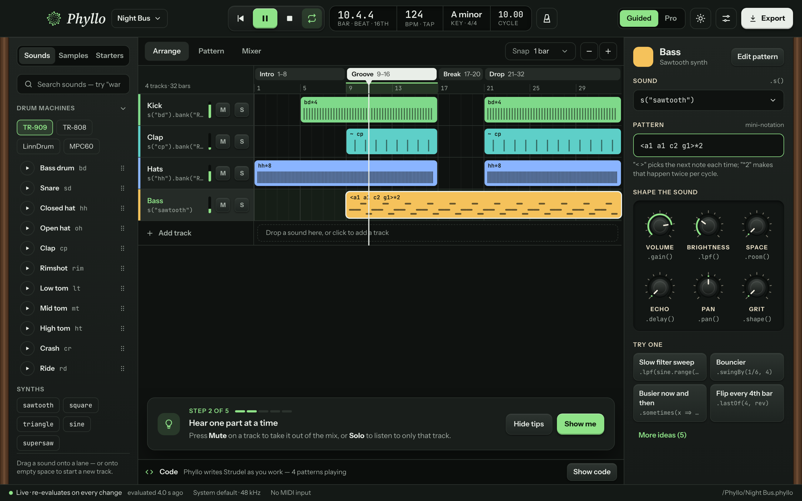
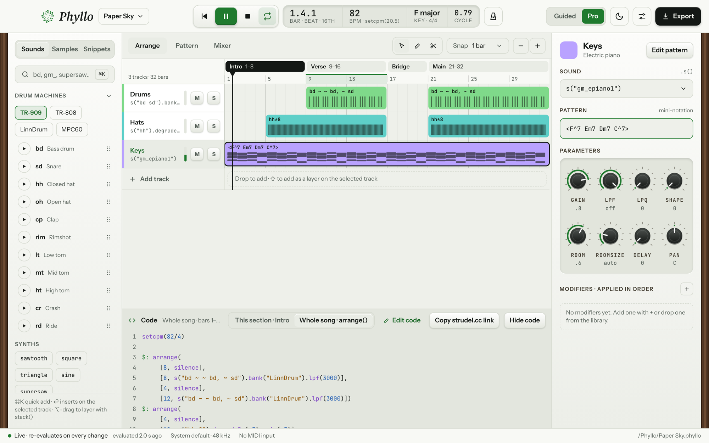
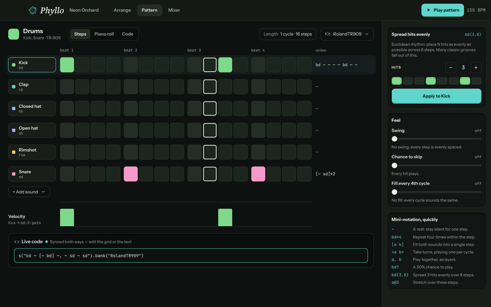
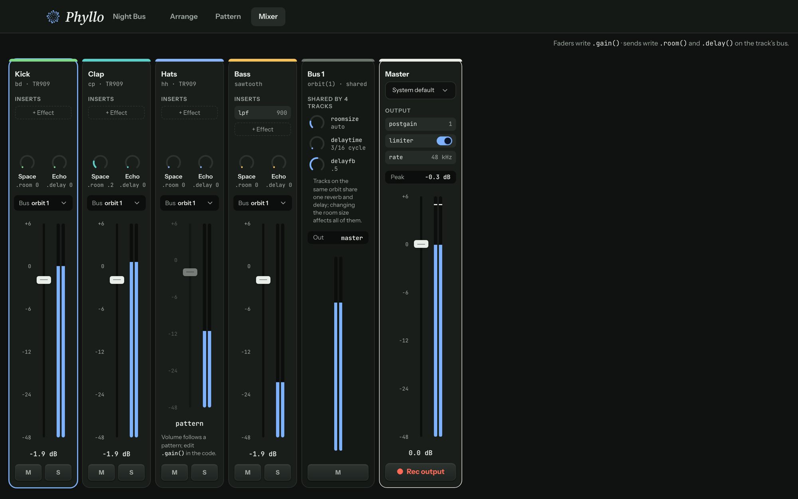
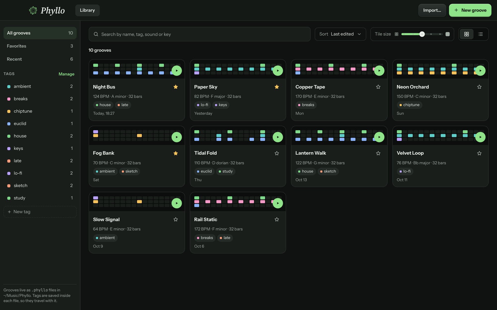
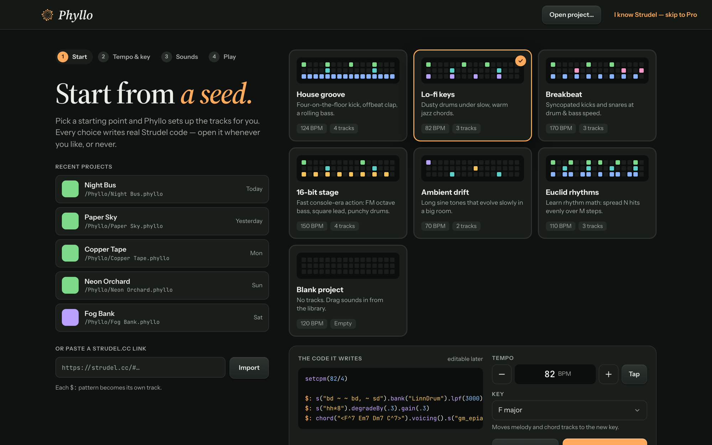
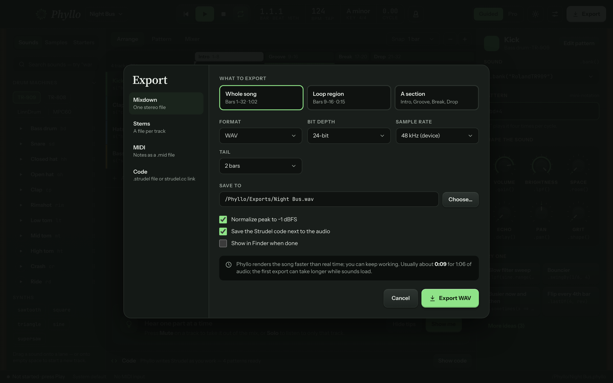
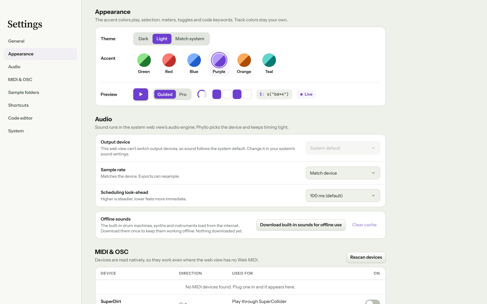

# Phyllo

A desktop DAW for [Strudel](https://strudel.cc), the JavaScript port of TidalCycles. Arrange tracks on a timeline, shape sounds with knobs, program steps on a grid, and mix — while Phyllo writes real Strudel code for every move. The code is never hidden: open it, copy it to strudel.cc, or edit it and watch the tracks follow.

Phyllo is a [Tauri 2](https://tauri.app) app: Strudel makes the sound inside the web view, and a Rust shell handles files, devices and the OS.

📖 **[Read the manual](https://pat-eason.github.io/phyllo/)** (or run it locally with `pnpm --filter phyllo-manual dev`): a tutorial for first-timers, one page per screen with annotated screenshots, and the exact Strudel mapping for live coders.



## Features

- **One track = one Strudel pattern.** Every track is a `$:` line; mute writes `_$:`, solo mutes the others, the arrangement becomes `arrange([…])`. Turning a knob rewrites the code within ~100 ms and the sound changes while it plays.
- **Code flows both ways.** Edit a pattern in the inspector, in the code drawer, or the whole song in Pro's *Edit code* mode; paste a strudel.cc link or open a `.strudel` file and each `$:` block becomes a track. Anything Phyllo can't map stays as a Code track — it never drops or rewrites code it didn't generate.
- **Guided and Pro.** Guided uses plain-language labels, six knobs, step-by-step tips and "Try one" suggestions; Pro shows Strudel names, eight knobs, a modifier chain and the code. Switching never changes the project.
- **Pattern editor.** A 16-step grid synced with mini-notation in both directions (`bd*4`, `[~ cp]*2`, `hh*8`), velocity lane, Euclidean fill (`bd(3,8)`), swing / chance / fill sliders, and a piano roll for melodic tracks.
- **Mixer.** Faders write `.gain()`, sends write `.room()` / `.delay()`; tracks on the same orbit share one reverb and delay; master limiter and postgain; per-track, bus and master meters; record the master output.
- **Groove library.** Projects are `.phyllo` files in `~/Music/Phyllo`; search, tags, favourites, recents, grid or list view, preview a groove without opening it. Autosave and version history.
- **Export.** Mixdown or stems to WAV / FLAC / MP3, MIDI files, `.strudel` code or a strudel.cc link. Audio renders offline, much faster than real time.
- **Native extras.** MIDI in/out (play the selected track, map CCs to knobs, record notes into a pattern), OSC to SuperDirt, linked sample folders, media keys, menu-bar mode, file associations, and an offline cache for Strudel's built-in sounds.
- **Themes.** Dark and light, six accent colours, keyboard-first controls, accessible names and contrast throughout.

## Screenshots

| | |
| --- | --- |
|  **Arrange, Pro** — code drawer showing the generated song |  **Pattern editor** — steps ↔ mini-notation |
|  **Mixer** — faders, sends, shared orbit bus, master |  **Groove library** |
|  **Guided start** — seeds, tempo, key, live code preview |  **Export** |
|  **Settings** — theme, accent, audio, MIDI & OSC | |

## Requirements

- **Node** 22 or newer and **pnpm** 10 (`corepack enable` picks up the pinned `pnpm@10.34.5`)
- **Rust** 1.95+ and the [Tauri prerequisites](https://v2.tauri.app/start/prerequisites/) for your OS (on macOS: Xcode Command Line Tools)
- A network connection the first time you use the built-in drum machines and instruments (they load from Strudel's CDN, then stay cached on disk). Synth sounds work offline.

Phyllo is developed and verified on macOS. The Rust side is cross-platform, but Windows and Linux builds haven't been tested.

## Run it

```bash
pnpm install
pnpm --filter phyllo tauri dev
```

The first run compiles the Rust side, which takes a minute or two. On first launch you land on **Guided start**: pick a starter, press **Continue**, then press **Space** (or the play key) to hear it.

To work on the frontend in a browser instead, without Tauri:

```bash
pnpm --filter phyllo dev      # http://localhost:1420
```

In the browser the native layer is replaced by an in-memory implementation that keeps projects in `localStorage` and downloads exports, so everything except devices and the file system works.

## Build a release app

```bash
pnpm --filter phyllo tauri build
```

The bundle lands in `src/apps/phyllo/src-tauri/target/release/bundle/` (on macOS: `macos/Phyllo.app`). The build isn't code-signed or notarized.

To check a release build end to end, run the self-test. It builds `Phyllo.app`, launches it against a temporary data folder, and drives the real app inside the Mac web view: open a starter, play it, edit it, save, reopen it from the library, and export WAV, MIDI, `.strudel` and FLAC. It prints a pass/fail report and cleans up after itself.

```bash
pnpm --filter phyllo selftest               # append --skip-build to reuse the last build
```

## Develop

```bash
pnpm check                                  # typecheck + lint + unit tests, every package
pnpm --filter phyllo e2e                    # Playwright user flows (first time: pnpm --filter phyllo exec playwright install chromium)
pnpm --filter @phyllo/engine e2e            # audio engine in a real browser
pnpm --filter phyllo e2e:visual             # capture every screen to test-results/screens/
pnpm stories                                # Storybook for atoms and molecules (port 6006)
pnpm --filter phyllo stories                # Storybook for organisms with mock stores (port 6007)
pnpm --filter phyllo-manual dev             # the user manual (VitePress, port 5180)
pnpm --filter phyllo-manual screenshots     # regenerate the manual's annotated screenshots from the live app
(cd src/apps/phyllo/src-tauri && cargo test) # Rust tests
```

## Repository layout

pnpm monorepo; all source lives under `src/`.

| Path | What it holds |
| --- | --- |
| `src/apps/phyllo` | The Tauri app. `src/state` (Zustand stores), `src/hooks` (the only way UI talks to state, engine and native), `src/native` (Tauri and in-browser implementations), `src/ui` (organisms, screens, shell), `src/selftest`. Rust in `src-tauri/`: project files, library index, history, sample folders, MIDI/OSC, export encoders, menu/tray/media keys, sound cache. |
| `src/packages/engine` | `@phyllo/engine`: code generation (project → Strudel), parsing (Strudel → project), mini-notation ↔ step grid, strudel.cc links, and the Strudel runtime (scheduling, errors, meters, offline render). |
| `src/packages/ui` | `@phyllo/ui`: design tokens, `ThemeProvider`, bundled fonts, and the atoms and molecules (knobs, faders, meters, clips, cards…) with stories. Knows nothing about Strudel or Tauri. |
| `src/shared/model` | `@phyllo/model`: the `.phyllo` project model, reducer, parameter specs, serialization, and content (starters, tips, sound and modifier catalogs). |
| `src/apps/manual` | The user manual: a VitePress static site published to GitHub Pages, with Playwright specs that capture its annotated screenshots. See its README. |
| `docs/` | Strudel API verification report and scripts, README screenshots. |

## How it works

The project model is the single source of truth. Every edit goes through a reducer; the engine regenerates the Strudel program (debounced ~60 ms) and hot-swaps it without stopping playback. If the new code fails, the last good program keeps playing and the failing track is marked. The playhead and meters update outside React, so playback doesn't re-render the UI.

This is the code the House groove starter generates (the Kick, Clap, Hats and Bass tracks in the screenshot above):

```js
setcpm(124/4)

$: arrange(
     [4, silence],
     [12, s("bd*4").bank("RolandTR909")],
     [4, silence],
     [12, s("bd*4").bank("RolandTR909")])
$: arrange(
     [8, silence],
     [8, s("~ cp").bank("RolandTR909").room(.2)],
     [4, silence],
     [12, s("~ cp").bank("RolandTR909").room(.2)])
$: arrange(
     [16, s("hh*8").bank("RolandTR909").gain("[.4 .7]*4")],
     [4, silence],
     [12, s("hh*8").bank("RolandTR909").gain("[.4 .7]*4")])
$: arrange([8, silence], [24, note("<a1 a1 c2 g1>*2").s("sawtooth").lpf(900)])
```

One cycle is one bar (`setcpm(bpm / beatsPerBar)`), so the timeline reads in bars like any DAW, and each clip on the timeline becomes an entry in that track's `arrange()`. Paste it into [strudel.cc](https://strudel.cc) and it plays the same.

## Where things are stored

| What | Where |
| --- | --- |
| Projects | `~/Music/Phyllo/*.phyllo` |
| Exports | `~/Music/Phyllo/Exports/` |
| Version history | `~/Music/Phyllo/.history/<project id>/` |
| Cached built-in sounds | `~/Music/Phyllo/.cache/sounds/` |
| Settings (theme, devices, prefs) | the app's config folder (on macOS `~/Library/Application Support/com.phyllo.app`) |

Set `PHYLLO_HOME` to use a different folder instead of `~/Music/Phyllo`.

## Keyboard shortcuts

| Key | Action |
| --- | --- |
| Space | Play / pause |
| L / R | Loop / arm MIDI record |
| M / S | Mute / solo the selected track |
| V / B / S | Select / Draw / Split tool (Pro, Arrange) |
| ⌘1 / ⌘2 / ⌘3 | Arrange / Pattern / Mixer |
| ⇧⌘L | Groove library |
| ⌘K | Search sounds (⏎ inserts onto the selected track) |
| ⌘/ | Show or hide the code |
| ⇧⌘G | Switch Guided / Pro |
| ⌘Z / ⇧⌘Z | Undo / redo |
| ⌘S / ⇧⌘S | Save / save as |
| ⌘N / ⌘O | New / open |
| ⌘E | Export |
| ⌘, | Settings |

Shortcuts never fire while you're typing in a field or the code editor.

## Known limitations

- **Output device:** the macOS web view can't route audio to a chosen device, so Phyllo plays through the system default output.
- **Built-in sounds** need the network once (Settings › Audio › *Download built-in sounds for offline use* fetches them all ahead of time).
- **Pattern editor** steps cover one bar of 16 steps; longer or triplet patterns stay editable as text.
- Not yet exercised with real hardware: MIDI devices, media keys, tray mode, OSC to SuperDirt.

## Project notes

- `PLAN.md`, `PROGRESS.md` and `DECISIONS.md` record how the app was built, what was verified, and every design decision and deviation.
- `docs/strudel-verification/REPORT.md` documents the Strudel APIs Phyllo relies on, checked against the pinned package source.

## License

No license has been chosen for Phyllo yet. Note that it depends on Strudel packages licensed **AGPL-3.0-or-later**, and MP3 export links the **LGPL** LAME encoder, so any distribution must be compatible with those terms.
